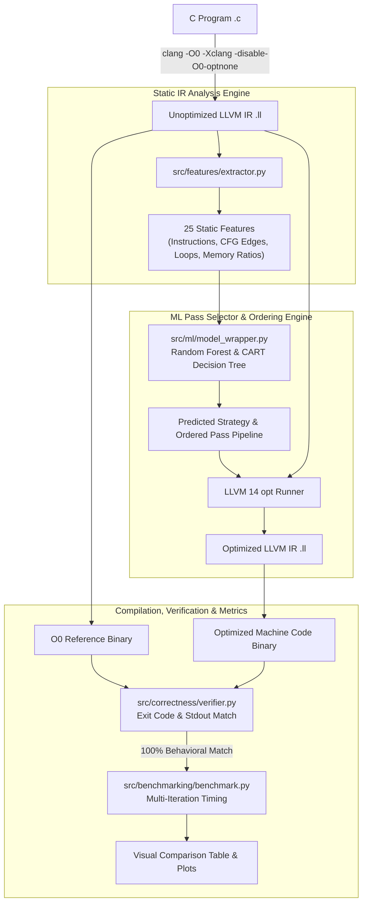

# Machine-Learning-Guided LLVM Optimization Pass Selector:

[](https://releases.llvm.org/14.0.0/)
[](https://ubuntu.com/)
[](https://python.org)
[]()
[]()

> **Course**: BCSE307P – Compiler Design Lab  
> **Project ID**: A26  
> **Team Size**: 4  
> **Review Stage**: Review 2 Functional Prototype & Evidence  

---

## 1. Project Overview & Research Question

Modern optimizing compilers such as LLVM rely on static, monolithic optimization pipelines (e.g., `-O2` and `-O3`). While effective on average, fixed pipelines cannot account for the diverse algorithmic structures of individual programs:
- **Phase Ordering Problem**: The sequence and order of passes non-linearly affects optimization efficacy.
- **Over-Optimization & Bloat**: Heavy loop unrolling and vectorization in `-O3` can inflate binary code size and degrade instruction cache locality on memory-bound or branch-heavy programs.

### The Core Research Question
> *"Can an ML-guided optimization strategy select an effective LLVM optimization pass sequence for a program, compared with fixed LLVM optimization pipelines such as -O2 and -O3?"*

This project implements an end-to-end framework that takes an arbitrary C program, compiles it to unoptimized LLVM Intermediate Representation (IR), extracts 25 static code features, uses a trained Machine Learning model (Random Forest / CART Decision Tree) to predict and order an optimal sequence of LLVM 14 passes, compiles the result to native machine code, and benchmarks runtime, code size, and functional correctness.

---

## 2. End-to-End System Architecture



---

## 3. Key Technical Contributions

1. **Zero External Python Dependencies for Core Engine**:
   - The entire feature extraction, compiler orchestration, CART Decision Tree, and Random Forest ensemble are written from scratch in pure Python using only standard library modules.
   - Runs out-of-the-box on any Ubuntu lab workstation without requiring `pip install` or internet access.
2. **LLVM 14 New Pass Manager Compatibility**:
   - Seamlessly uses LLVM 14's `-passes='pass1,pass2,...'` syntax and handles clang's `optnone` attribute bypass (`-Xclang -disable-O0-optnone`).
3. **Rigorous, Authentic Benchmarking (Zero Fabricated Numbers)**:
   - All performance data is measured on live hardware executions using median timing (7 runs per -O0/-O2/-O3 baseline, 5 per candidate strategy) after a warm-up run, to reduce OS scheduler variance.
   - 100% functional correctness verified across 270 optimized builds (60 `-O2`/`-O3` builds and 210 candidate-strategy builds), each checked against the `-O0` reference.
   - ML results are reported with **leave-one-out** evaluation: each program's strategy is predicted by a model that never saw that program.
4. **Pass Ordering & Heuristic Beam Search**:
   - Implements beam search ($D=4, B=2$) and permutation ordering analysis to demonstrate the impact of pass order on code size and instruction counts.

---

## 4. Static IR Feature Taxonomy (25 Features)

The feature extractor (`src/features/extractor.py`) parses the textual LLVM IR assembly, constructs the Control Flow Graph (CFG), and computes:

| Category | Features | Compiler Rationale |
|:---|:---|:---|
| **Volume & Scale** | `instruction_count`, `basic_block_count`, `function_count` | Establishes base program size and complexity. |
| **Loop Structure** | `loop_count` | Detected via CFG back-edge cycle detection; targets `loop-rotate`, `licm`, `loop-unroll`. |
| **Control Flow** | `branch_count`, `cond_branch_count`, `uncond_branch_count`, `branch_to_bb_ratio` | Identifies branch density for `simplifycfg` and jump threading. |
| **Memory Operations** | `load_count`, `store_count`, `alloca_count`, `gep_count`, `mem_op_count`, `load_store_ratio`, `mem_to_total_ratio` | Distinguishes compute-bound from memory-bound programs; drives `mem2reg` and `gvn`. |
| **Computation & SSA** | `arithmetic_count`, `bitwise_count`, `cmp_count`, `call_count`, `ret_count`, `phi_count`, `arith_to_total_ratio`, `phi_to_bb_ratio` | Directs `instcombine`, `reassociate`, `sccp`, and `tailcallelim`. |
| **Program Structure** | `is_recursive`, `max_branch_depth` | `is_recursive` is 1 if any function reaches itself in the direct call graph (self or mutual recursion), relevant to `tailcallelim` and inlining limits. `max_branch_depth` is the largest number of conditional branches on any acyclic path through a function's CFG (loop back-edges ignored), measuring decision nesting for `simplifycfg` and jump threading. |

Results are also reported **by program feature** rather than by program name: recursion, branch depth, loop count, memory intensity and program size. See `results/feature_category_summary.csv` and `plots/speedup_by_*.svg`, both produced by `plots/generate_plots.py`.

---

## 5. Controlled Optimization Pass Space

The framework operates on a controlled set of 16 verified LLVM 14 passes:
- **Memory & SSA Promotion**: `mem2reg`
- **Instruction Simplification**: `instcombine`, `reassociate`, `aggressive-instcombine`
- **Control Flow Optimization**: `simplifycfg`, `tailcallelim`
- **Redundancy & Constant Propagation**: `gvn`, `sccp`, `ipsccp`
- **Dead Code Elimination**: `dce`, `adce`, `dse`
- **Loop Transformations**: `loop-rotate`, `licm`, `loop-unroll`, `loop-simplifycfg`

### Named Strategy Pipelines
- **`scalar_cleanup`**: `mem2reg,instcombine,simplifycfg`
- **`arithmetic_constant`**: `mem2reg,instcombine,reassociate,sccp,dce`
- **`loop_intensive`**: `mem2reg,loop-rotate,licm,loop-unroll,instcombine,simplifycfg`
- **`memory_redundancy`**: `mem2reg,gvn,dse,instcombine,simplifycfg`
- **`code_size_dce`**: `mem2reg,simplifycfg,instcombine,dce,adce`
- **`full_scalar_licm`**: `mem2reg,sccp,loop-rotate,licm,instcombine,simplifycfg,dce`
- **`tailcall_simplify`**: `mem2reg,tailcallelim,simplifycfg,instcombine,dce`

These 7 strategies are the candidate classes the model chooses between. Under the LLVM 14 new pass manager, `licm` requires MemorySSA, so `PassRunner` runs it as `loop-mssa(licm)`. Optimized IR is turned into machine code with `llc -O2` (`-O3` for the `-O3` baseline); the `-O0` reference uses unoptimized code generation.

---

## 6. Project Structure

```
ml-optimization-pass-selector/
├── README.md                      # Complete project documentation & guide
├── requirements.txt               # Documented dependencies
├── run_optimizer                  # Direct executable launcher script
├── src/
│   ├── main.py                    # Unified CLI entry point
│   ├── llvm/
│   │   ├── compiler.py            # Clang wrapper for C -> IR and IR -> binary
│   │   └── pass_runner.py         # LLVM 14 opt runner with new PM syntax
│   ├── features/
│   │   └── extractor.py           # Automated static IR feature extractor
│   ├── optimization/
│   │   ├── pass_pool.py           # LLVM 14 candidate pass catalog
│   │   ├── sequence_generator.py  # Named strategies & candidate pipelines
│   │   └── ordering_search.py     # Beam search & pass ordering sensitivity engine
│   ├── ml/
│   │   ├── decision_tree.py       # Pure-Python CART Decision Tree (Gini splits)
│   │   ├── random_forest.py       # Pure-Python Random Forest ensemble (Bagging)
│   │   ├── model_wrapper.py       # Model training, prediction & serialization
│   │   └── train.py               # Model training script & validation
│   ├── benchmarking/
│   │   ├── benchmark.py           # Multi-run timer & binary size meter
│   │   └── baseline_runner.py     # O0, O2, O3 evaluation harness
│   ├── correctness/
│   │   └── verifier.py            # Semantic equivalence checking against O0
│   └── utils/
│       └── visualizer.py          # ASCII tables, banners, and console reports
├── tests/
│   ├── sample.c                   # Baseline sample loop program
│   ├── sample.ll                  # Baseline unoptimized IR
│   ├── sample_O2.ll               # Baseline O2 optimized IR
│   ├── programs/                  # Benchmark suite (29 C programs; 30 with tests/sample.c)
│   │   ├── ackermann.c            # Deep non-primitive recursion
│   │   ├── binary_search.c        # Iterative binary search
│   │   ├── bit_manipulation.c     # Bitwise counting and reversal
│   │   ├── branch_heavy.c         # Multi-case switch and nested conditions
│   │   ├── bubble_sort.c          # Array sorting and element swapping
│   │   ├── bytecode_vm.c          # Switch-dispatch stack interpreter
│   │   ├── collatz.c              # Collatz conjecture cycle lengths
│   │   ├── convolution_2d.c       # 3x3 image convolution (stencil loops)
│   │   ├── factorial.c            # Recursion with arithmetic operations
│   │   ├── fibonacci.c            # Double recursion branching
│   │   ├── hash_table.c           # Hash table with linear probing
│   │   ├── histogram.c            # Byte histogram (indirect array updates)
│   │   ├── insertion_sort.c       # Insertion sort (shifting inner loop)
│   │   ├── linear_search.c        # Linear array scan with early exit
│   │   ├── linked_list.c          # List build, reverse and traversal (pointer chasing)
│   │   ├── mandelbrot.c           # Floating-point escape-time loop
│   │   ├── matrix_multiply.c      # 2D matrix multiplication (triple loops)
│   │   ├── matrix_transpose.c     # Strided 2D transpose and copy
│   │   ├── merge_sort.c           # Recursive merge sort
│   │   ├── n_queens.c             # Recursive backtracking
│   │   ├── nested_loops.c         # Triple nested arithmetic accumulation
│   │   ├── permutations.c         # Recursive permutation enumeration
│   │   ├── prime_sieve.c          # Sieve of Eratosthenes
│   │   ├── quick_sort.c           # Recursive quicksort (Lomuto partition)
│   │   ├── roman_numerals.c       # Roman numeral conversion (long if-else chains)
│   │   ├── string_reverse.c       # In-place string reversal
│   │   ├── tower_of_hanoi.c       # Recursive Tower of Hanoi
│   │   ├── triangle_classifier.c  # Deeply nested conditionals
│   │   └── vector_dot_product.c   # Vector arithmetic & dot product
│   ├── unit/                      # Automated unit test suite
│   │   ├── test_feature_extractor.py
│   │   ├── test_pass_runner.py
│   │   ├── test_ml_model.py
│   │   ├── test_verifier.py
│   │   └── test_web_server.py
│   └── integration/
│       └── test_pipeline.py       # End-to-end integration test
├── data/
│   ├── baseline_results.csv       # Measured O0, O2, O3 metrics across all benchmarks
│   ├── optimization_dataset.csv   # Feature matrix + pass sequence exploration data (210 records: 30 programs x 7 strategies)
│   └── optimization_dataset.json  # JSON dataset
├── models/
│   └── trained_selector.json      # Serialized model weights & metadata (incl. leave-one-out predictions)
├── plots/
│   ├── generate_plots.py          # SVG plot and summary generator
│   ├── execution_time_comparison.svg
│   ├── speedup_comparison.svg
│   └── speedup_by_*.svg           # Speedup by recursion, branch depth, loop count, memory intensity, size
├── results/
│   ├── comparison_summary.csv     # Per-program ML vs O2 vs O3 comparison with feature groups
│   └── feature_category_summary.csv  # Results aggregated by program feature group
└── docs/
    ├── architecture.md            # Detailed system architecture and data flows
    ├── methodology.md             # Theoretical formulation & algorithms
    ├── testing.md                 # Test matrices, correctness proof & defect log
    └── results.md                 # Empirical performance analysis & viva Q&A
```

---

## 7. Quickstart & Usage Instructions

### Prerequisites
- **Ubuntu 22.04 LTS** (or compatible Linux distribution; on Windows, use WSL2 with Ubuntu 22.04)
- **Clang & LLVM 14**: `sudo apt install clang-14 llvm-14 build-essential`, then `export PATH=/usr/lib/llvm-14/bin:$PATH`. The `llvm-14` package provides `opt` (pass execution) and `llc` (code generation); both are required.
- **Python 3.8+** (standard library only; no external pip packages required)

### 1. Launch Interactive Web Dashboard Frontend
```bash
python3 src/main.py --web
```
*Launches an interactive, browser-based dashboard at `http://localhost:8080` featuring live single-program optimization, benchmark suite charts, ML feature importances, and pass ordering search.*

### 2. Run End-to-End ML Optimization on a Program (CLI)
```bash
python3 src/main.py --input tests/programs/matrix_multiply.c --strategy ml
```

### 3. Run Pass Ordering Exploration (Beam Search & Order Permutations)
```bash
python3 src/main.py --input tests/sample.c --explore-ordering
```

### 3. Re-train the Machine Learning Model
```bash
python3 src/main.py --train
```

### 4. Run Baseline Benchmarking on All Programs
```bash
python3 src/main.py --benchmark-all
```

### 5. Generate Visual SVG Plots and Summary Tables
```bash
python3 plots/generate_plots.py
```

### 6. Run Automated Test Suite
```bash
python3 -m unittest tests.unit.test_feature_extractor tests.unit.test_pass_runner tests.unit.test_ml_model tests.unit.test_verifier tests.unit.test_web_server tests.integration.test_pipeline -v
```

---

## 8. Example Console Output

Running `python3 src/main.py --input tests/programs/matrix_multiply.c --strategy ml` (WSL2 Ubuntu 22.04, LLVM 14):

```
========================================================================
            MACHINE-LEARNING-GUIDED OPTIMIZATION PASS SELECTOR
           Compiler Design Lab Project A26 — Review 2 Prototype
========================================================================

[Step 1] Preparing LLVM IR for target: tests/programs/matrix_multiply.c
  Generated unoptimized IR with -disable-O0-optnone -> /tmp/opt_selector_matrix_multiply_m5tphtr0/matrix_multiply_unopt.ll

[Step 2] Extracting static IR features...

[Program Static IR Features]
  * instruction_count         185    |  * bitwise_count               0
  * basic_block_count          34    |  * cmp_count                   8
  * function_count              2    |  * call_count                  2
  * loop_count                  8    |  * ret_count                   2
  * branch_count               32    |  * mem_op_count              109
  * cond_branch_count           8    |  * load_store_ratio       1.6667
  * uncond_branch_count        24    |  * mem_to_total_ratio     0.5892
  * load_count                 45    |  * arith_to_total_ratio   0.0973
  * store_count                27    |  * branch_to_bb_ratio     0.9412
  * alloca_count               16    |  * phi_to_bb_ratio             0
  * gep_count                  21    |  * is_recursive                0
  * phi_count                   0    |  * max_branch_depth            4
  * arithmetic_count           18

[Step 3] Querying Machine Learning model for optimization passes...
  ML Predicted Strategy:   'loop_intensive' (confidence: 68.0%)
  Selected Pass Sequence:  mem2reg,loop-rotate,licm,loop-unroll,instcombine,simplifycfg

[Step 4] Compiling and benchmarking baselines vs ML-guided pipeline...

[Comparative Performance Summary]
---------------------------------

Strategy                     | Execution Time | Speedup vs O0 | Binary Size | IR Lines | Correctness
-----------------------------+----------------+---------------+-------------+----------+------------
O0 (Unoptimized)             |       2.488 ms |         1.00x |     16080 B |      287 |     PASS
-O2 (Default)                |       1.445 ms |         1.72x |     16080 B |      249 |     PASS
-O3 (Default)                |       1.331 ms |         1.87x |     20176 B |      620 |     PASS
ML-Selected (loop_intensive) |       1.691 ms |         1.47x |     16080 B |      180 |     PASS

Observations:
  • ML pass sequence took 17.1% longer than standard -O2.
  • ML pass sequence took 27.1% longer than standard -O3.
  • Functional correctness verified: True
```

---

## 9. Empirical Results & Findings

### Performance Benchmark Across 30 Programs
*Medians of repeated runs (7 per -O0/-O2/-O3 baseline, 5 per candidate strategy, each after 1 warm-up) on WSL2 Ubuntu 22.04 with LLVM 14. "ML" is the strategy predicted for each program by a model trained on the other 29 programs (leave-one-out); "Best Candidate" is the fastest of the 7 candidate strategies for that program. Sorted by speedup vs -O2.*

| Program | -O0 (ms) | -O2 (ms) | -O3 (ms) | ML (ms) | ML Strategy (LOO) | Best Candidate | Speedup vs O2 | Speedup vs O3 |
|:---|:---:|:---:|:---:|:---:|:---|:---|:---:|:---:|
| `roman_numerals` | 20.01 | 12.11 | 10.60 | 6.10 | `code_size_dce` | `code_size_dce` | **1.99x** | **1.74x** |
| `triangle_classifier` | 6.52 | 4.09 | 3.98 | 2.30 | `code_size_dce` | `code_size_dce` | **1.78x** | **1.73x** |
| `string_reverse` | 20.35 | 5.60 | 5.81 | 3.23 | `tailcall_simplify` | `scalar_cleanup` | **1.73x** | **1.80x** |
| `fibonacci` | 6.68 | 3.77 | 3.98 | 2.21 | `tailcall_simplify` | `tailcall_simplify` | **1.70x** | **1.80x** |
| `matrix_transpose` | 27.20 | 11.89 | 12.22 | 7.48 | `loop_intensive` | `loop_intensive` | **1.59x** | **1.63x** |
| `quick_sort` | 25.29 | 15.47 | 16.13 | 9.79 | `full_scalar_licm` | `scalar_cleanup` | **1.58x** | **1.65x** |
| `factorial` | 20.38 | 4.19 | 4.86 | 2.69 | `tailcall_simplify` | `tailcall_simplify` | **1.56x** | **1.80x** |
| `tower_of_hanoi` | 40.49 | 26.58 | 28.00 | 17.61 | `tailcall_simplify` | `tailcall_simplify` | **1.51x** | **1.59x** |
| `n_queens` | 13.44 | 6.68 | 6.61 | 4.45 | `loop_intensive` | `code_size_dce` | **1.50x** | **1.49x** |
| `insertion_sort` | 20.76 | 7.34 | 7.23 | 4.93 | `loop_intensive` | `loop_intensive` | **1.49x** | **1.47x** |
| `mandelbrot` | 11.27 | 4.64 | 5.27 | 3.14 | `full_scalar_licm` | `code_size_dce` | **1.48x** | **1.68x** |
| `linked_list` | 90.82 | 97.68 | 106.53 | 67.62 | `scalar_cleanup` | `full_scalar_licm` | **1.44x** | **1.57x** |
| `sample` | 1.05 | 0.77 | 0.66 | 0.55 | `tailcall_simplify` | `code_size_dce` | **1.41x** | **1.21x** |
| `nested_loops` | 97.31 | 62.66 | 58.03 | 45.00 | `tailcall_simplify` | `arithmetic_constant` | **1.39x** | **1.29x** |
| `linear_search` | 120.80 | 50.07 | 47.92 | 36.29 | `full_scalar_licm` | `tailcall_simplify` | **1.38x** | **1.32x** |
| `histogram` | 5.63 | 3.40 | 3.71 | 2.65 | `loop_intensive` | `tailcall_simplify` | **1.28x** | **1.40x** |
| `bubble_sort` | 1.81 | 1.36 | 1.11 | 1.07 | `loop_intensive` | `loop_intensive` | **1.27x** | **1.03x** |
| `prime_sieve` | 1.23 | 0.88 | 0.80 | 0.75 | `tailcall_simplify` | `full_scalar_licm` | **1.17x** | **1.06x** |
| `bytecode_vm` | 10.73 | 10.49 | 10.23 | 9.34 | `loop_intensive` | `tailcall_simplify` | **1.12x** | **1.10x** |
| `merge_sort` | 33.31 | 14.74 | 15.38 | 13.29 | `code_size_dce` | `memory_redundancy` | **1.11x** | **1.16x** |
| `branch_heavy` | 2.80 | 2.44 | 1.65 | 2.22 | `loop_intensive` | `arithmetic_constant` | **1.10x** | 0.74x |
| `convolution_2d` | 13.97 | 1.55 | 1.73 | 1.46 | `loop_intensive` | `loop_intensive` | **1.06x** | **1.19x** |
| `vector_dot_product` | 67.99 | 16.85 | 13.51 | 16.14 | `tailcall_simplify` | `memory_redundancy` | **1.04x** | 0.84x |
| `bit_manipulation` | 9.71 | 2.74 | 1.24 | 3.03 | `tailcall_simplify` | `full_scalar_licm` | 0.90x | 0.41x |
| `collatz` | 339.26 | 59.22 | 54.15 | 66.81 | `tailcall_simplify` | `loop_intensive` | 0.89x | 0.81x |
| `hash_table` | 5.18 | 3.68 | 2.91 | 4.31 | `loop_intensive` | `arithmetic_constant` | 0.85x | 0.68x |
| `binary_search` | 83.69 | 21.79 | 24.56 | 28.79 | `loop_intensive` | `full_scalar_licm` | 0.76x | 0.85x |
| `matrix_multiply` | 2.67 | 1.11 | 1.19 | 1.59 | `code_size_dce` | `loop_intensive` | 0.69x | 0.75x |
| `permutations` | 35.24 | 8.83 | 8.64 | 16.32 | `full_scalar_licm` | `loop_intensive` | 0.54x | 0.53x |
| `ackermann` | 41.12 | 2.44 | 2.06 | 24.62 | `tailcall_simplify` | `tailcall_simplify` | 0.10x | 0.08x |

### Summary Analysis
- **ML matched or outperformed `-O2` on 23/30 benchmarks (76.7%)**, with a geometric-mean speedup of **1.14x** over `-O2`.
- **ML matched or outperformed `-O3` on 21/30 benchmarks (70.0%)**, geometric mean **1.07x** over `-O3`.
- Geometric-mean speedup over `-O0`: `-O2` 2.36x, `-O3` 2.50x, ML 2.68x, best candidate 3.09x.
- **Model accuracy**: the leave-one-out prediction was the fastest candidate strategy on **10/30 programs (33.3% LOOCV accuracy)**; training accuracy is 96.7%. No predicted strategy failed on any program.
- **Where ML Excels**: branch-dense and loop programs where a short scalar pipeline beats the full default pipeline, e.g. `roman_numerals` (**1.99x** vs `-O2`), `triangle_classifier` (**1.78x**) and `string_reverse` (**1.73x**).
- **Where -O2/-O3 Excel**: `ackermann` (0.10x), `permutations` (0.54x) and `matrix_multiply` (0.69x). These likely benefit from interprocedural transformations (inlining) and vectorization that are not part of the candidate pass pool.

### Results by Program Feature
Programs grouped by static IR features (full table with all five dimensions in `docs/results.md` and `results/feature_category_summary.csv`):

| Group | Programs | Geomean ML vs -O2 | ML Wins vs -O2 |
|:---|:---:|:---:|:---:|
| Non-recursive | 22 | **1.22x** | 17/22 |
| Recursive | 8 | 0.93x | 6/8 |
| Shallow (<= 2) | 11 | **1.02x** | 8/11 |
| Moderate (2-4] | 12 | **1.09x** | 8/12 |
| Deep (> 4) | 7 | **1.44x** | 7/7 |

---

## 10. Limitations & Future Work

1. **Vectorization & Inlining Integration**: The current candidate pass pool focuses on scalar, memory, and loop control-flow passes. Integrating LLVM's `inline`, `loop-vectorize` and `slp-vectorizer` should close the gap on recursion-heavy programs (e.g. `ackermann`, 0.10x vs `-O2`) and SIMD-friendly workloads.
2. **Model Accuracy**: With 30 training programs, the selector picks the single fastest strategy for 33.3% of unseen programs (leave-one-out). More training programs, and treating near-tied strategies as equally correct, are expected to improve this.
3. **Dataset Expansion**: The current dataset contains 30 curated benchmark programs. Expanding to standard benchmark suites (e.g., PolyBench or SPEC CPU) with thousands of functions will enhance generalization.
4. **Reinforcement Learning Formulation**: Extending from static sequence prediction to deep Q-learning / PPO over iterative pass transitions is a promising avenue for Review 3.

---

## 11. Member-Wise Contribution Breakdown (Team Size: 4)

| Member Name | Core Module & Responsibility | Technical Contributions & Deliverables |
|:---|:---|:---|
| **Member 1 (Aarush Sanghi)** | **Compiler Driver & Pass Runner Architecture** | • Implemented `LLVMCompiler` and `PassRunner` with LLVM 14 New Pass Manager support (`-passes=...`).<br>• Solved `optnone` attribute bypass with `-disable-O0-optnone`.<br>• Integrated end-to-end CLI workflow (`src/main.py`, `run_optimizer`). |
| **Member 2** | **Static IR Feature Extraction Engine** | • Implemented `IRFeatureExtractor` in `src/features/extractor.py`.<br>• Formulated CFG cycle detection for natural loop counting.<br>• Derived memory and arithmetic ratio features across basic blocks. |
| **Member 3** | **Machine Learning Engine & Pass Ordering** | • Implemented pure-Python CART `DecisionTree` with Gini splits and `RandomForest` ensemble in `src/ml/`.<br>• Built `PassOrderingExplorer` with beam search ($D=4, B=2$) and permutation analysis.<br>• Implemented feature importance scoring and serialization. |
| **Member 4** | **Benchmarking, Correctness & Visualizations** | • Implemented `BenchmarkEngine` with multi-iteration median timing.<br>• Implemented `CorrectnessVerifier` asserting stdout and exit code equivalence against O0.<br>• Developed SVG/PNG plot generation (`plots/generate_plots.py`) and unit tests. |
